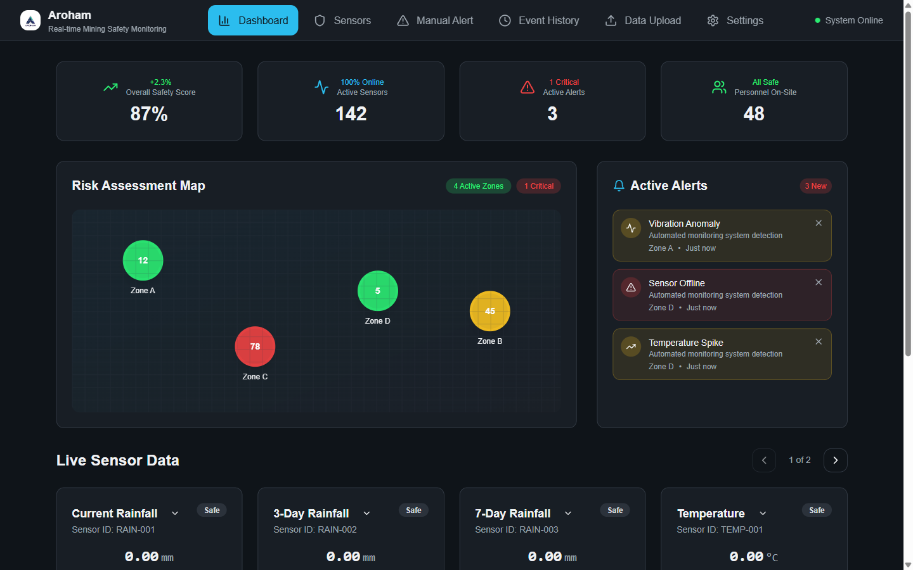
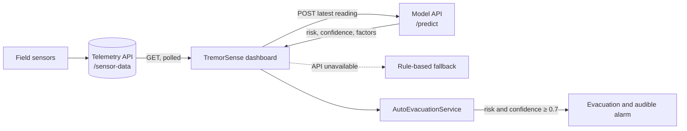

<div align="center">

# TremorSense

**Real-time slope-stability monitoring for mines: live geotechnical telemetry, ML risk inference and automated evacuation alerting.**

[](LICENSE)
[](https://react.dev)
[](https://www.typescriptlang.org)
[](https://vite.dev)
[](https://tailwindcss.com)

[Project write-up](https://www.divyakush.com/projects/rockfall-prediction) · [Report a bug](https://github.com/Divyakush2006/tremor-sense-stream/issues/new/choose) · [Request a feature](https://github.com/Divyakush2006/tremor-sense-stream/issues/new/choose)



</div>

## Overview

TremorSense is the control-room console for a rockfall and landslide early-warning system. It watches a network of field sensors measuring rainfall, temperature, soil strain and pore-water pressure, sends the latest readings to a hazard model, and, when the model reports high risk with enough confidence, starts an evacuation workflow with audible alarms. The interface ships under the site brand **Aroham**.

The dashboard is the monitoring and control surface. Telemetry storage and model inference are external services it connects to over HTTP (see [Integrations](#integrations)). When the model service is unreachable, a built-in rule-based fallback keeps scoring the readings, so monitoring never goes dark.

## Features

- **Live dashboard:** overall safety score, active sensors, open alerts, personnel on site, a zone risk map and live sensor cards.
- **Sensor management:** per-sensor status and readings for every channel.
- **ML risk inference:** each new reading is scored by the configured model API, which returns a risk flag, a confidence score and the contributing factors.
- **Automated evacuation:** an evacuation is triggered when the model reports high risk with confidence ≥ 0.7, and stood down when risk clears.
- **Manual emergency controls:** operators can sound the alarm for drills or observed conditions, with an audible buzzer.
- **Event history:** a searchable timeline of past events and alerts.
- **CSV upload:** import recorded telemetry for replay and analysis.
- **Settings:** notification delivery, alert thresholds, monitoring configuration, and database and model connections.

## Architecture



| Layer | Contents |
| --- | --- |
| Pages | Dashboard, Sensors, Manual Alert, Event History, Data Upload, Settings |
| Services | `DatabaseService` (telemetry), `MLModelService` (inference plus fallback), `AutoEvacuationService` (evacuation policy) |
| State | `SettingsContext`, TanStack Query, React hooks |
| UI | shadcn/ui on Radix primitives, Tailwind CSS, Recharts, Lucide icons |

## Integrations

Both endpoints are configured from **Settings → Database Management** at runtime; nothing is hard-coded.

### Telemetry API

`GET {databaseUrl}/sensor-data` with `Authorization: Bearer <apiKey>` returns an array of readings:

```json
[
  {
    "id": "r-001",
    "timestamp": "2026-01-01T10:00:00Z",
    "Rainfall_mm": 12.4,
    "Rainfall_3Day": 38.0,
    "Rainfall_7Day": 71.5,
    "Temperature_C": 24.1,
    "Soil_Strain": 0.0021,
    "Pore_Water_Pressure_kPa": 41.8,
    "sensor_location": "Zone A"
  }
]
```

### Model API

`POST {modelApiUrl}/predict`, with an optional bearer token, receives the latest reading:

```json
{
  "features": {
    "rainfall_mm": 12.4, "rainfall_3day": 38.0, "rainfall_7day": 71.5,
    "temperature_c": 24.1, "soil_strain": 0.0021, "pore_water_pressure_kpa": 41.8
  },
  "timestamp": "2026-01-01T10:00:00Z",
  "location": "Zone A"
}
```

It should respond with `risk_level` (or `prediction: 1` for high risk), a `confidence` between 0 and 1, and an optional `contributing_factors` array.

## Tech stack

| Layer | Technology |
| --- | --- |
| Framework | React 18, TypeScript, Vite 5 |
| UI | shadcn/ui (Radix primitives), Tailwind CSS, Lucide icons |
| Charts | Recharts |
| Data and state | TanStack Query, React Context |
| Forms and validation | React Hook Form, Zod |
| Routing | React Router 6 |
| Notifications | Sonner |

## Getting started

### Prerequisites

- [Node.js](https://nodejs.org) 18 or later, with npm

### Run locally

```bash
git clone https://github.com/Divyakush2006/tremor-sense-stream.git
cd tremor-sense-stream
npm install
npm run dev
```

The app is served at <http://localhost:8080>. Connect your telemetry and model APIs under **Settings**.

### Scripts

| Command | Description |
| --- | --- |
| `npm run dev` | Start the development server with hot reload |
| `npm run build` | Create a production build in `dist/` |
| `npm run preview` | Serve the production build locally |
| `npm run lint` | Lint the project with ESLint |

## Project structure

```
src/
├── pages/          # Dashboard, Sensors, ManualAlert, EventHistory, Upload, Settings
├── services/       # DatabaseService, MLModelService, AutoEvacuationService
├── components/     # Layout, SensorCard, DatabaseConfig, ui/ (shadcn)
├── contexts/       # SettingsContext
├── hooks/          # use-mobile, use-toast
└── lib/            # Shared utilities
models/             # Serialized model artefact (model.pkl) used by the inference service
public/             # Static assets, including the alarm sound
```

## Deployment

`npm run build` outputs a static site to `dist/`. It can be hosted on any static host, for example Cloudflare Pages (build command `npm run build`, output directory `dist`). Configure the host to serve `index.html` for unknown paths, because routing is client-side.

## Contributing

Contributions are welcome. Please read the [contributing guide](https://github.com/Divyakush2006/.github/blob/main/CONTRIBUTING.md) before opening a pull request.

## Security

Please report vulnerabilities privately as described in the [security policy](https://github.com/Divyakush2006/.github/blob/main/SECURITY.md). Do not open a public issue.

## License

Released under the [Apache License 2.0](LICENSE).

## Author

**Divyakush Punjabi** · [www.divyakush.com](https://www.divyakush.com) · [GitHub](https://github.com/Divyakush2006) · [LinkedIn](https://linkedin.com/in/divyakush-punjabi)
